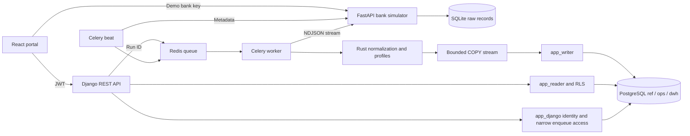
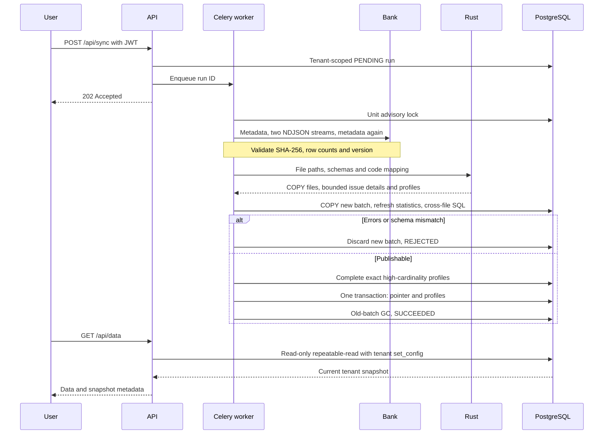
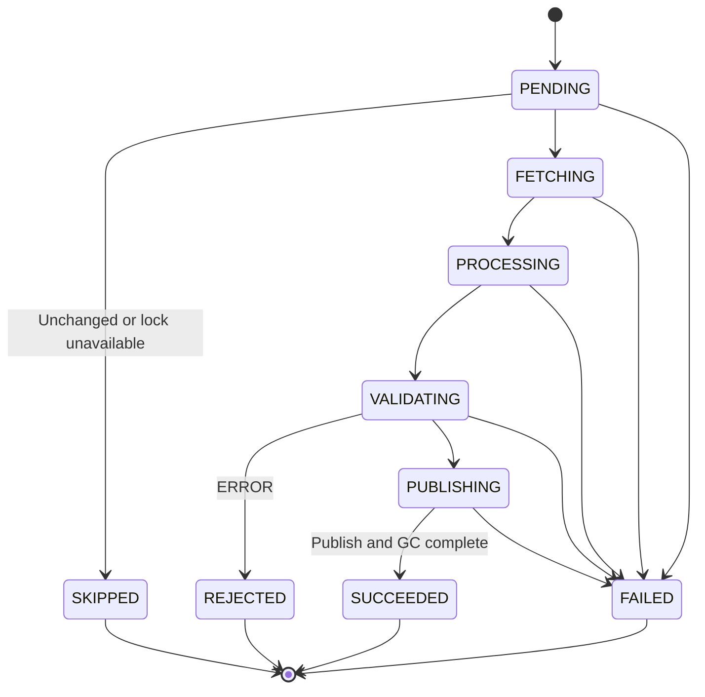
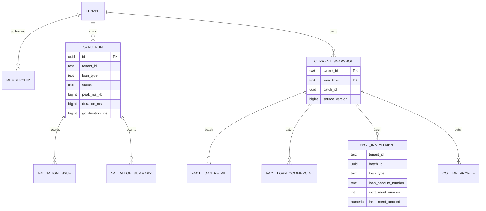

# Architecture

The synchronization unit is **tenant × loan type**. Credit and payment plan
share one batch and are validated and published together with their profiles.
See [architect.md](architect.md) for implementation challenges and trade-offs.

## Components and trust boundaries

Only loopback ports 5173, 8000 and 8001 are exposed. Database and Redis stay on the
compose network. Django runserver, Vite dev server and demo credentials are local
evaluation choices, not a production deployment design.

## Synchronization sequence

## State machine

Network retries preserve the FAILED run and create a new RETRY run. A GC error
after publication does not delete the published batch. A crashed-worker reaper
remains optional work rather than an implemented recovery claim.

## Logical entity relationships

Batch relationships are logical; not every line represents a physical FK.
Business keys are intentionally nonunique so duplicate/orphan inputs can be
loaded and reported before rejection. Each fact parent has three tenant
partitions. `ref.code_mapping` stores normalization aliases.

## Decision summary

- PyO3 keeps Rust processing inside the worker while Python owns I/O and transactions.
- PostgreSQL combines atomic multi-table publication and RLS without another database.
- Tenant identity comes from JWT; reader transactions enforce both tenant and snapshot.
- Pointer publication avoids parent-table DDL locks; GC cost is measured separately.
- Metadata polling avoids unchanged downloads; Celery provides asynchronous work.
- ERROR/WARNING/CORRECTED preserve distinctions required by dirty financial data.
- Decimal normalization/storage and explicitly floating-point statistics have separate roles.
- Import contracts enforce architecture rather than leaving it as diagram-only intent.

## Profile completeness and portal recovery

Validated, unpublished rows are the source for SQL profile completion. The unit
lock prevents concurrent publication; aggregation finishes before the short
pointer/profile transaction. Failure discards the new batch and retains the
previous data and profiles. The high_cardinality flag describes the Rust memory
threshold, not missing API statistics.

Data-page cursors contain the snapshot identity. A stale cursor returns a readable
400 problem; the portal can clear only the selected tenant/type/dataset pages and
restart. Dataset switches reset the scroll viewport. Metadata attributes package,
image and API ownership to Levent Çelik without a visible UI signature.

## Limits

Bank credit/plan uploads are separate operations. Intermediate polls may reject
an incomplete source update while DWH readers retain the old snapshot. Rust caps its category map at 1,000; PostgreSQL completes exact distinct counts,
modes and top-ten values before publication, returning only bounded summaries. Archived
snapshots, API-key authentication, reaper and rate limiting are not complete.
See the technical design for all ADRs and the report for measured acceptance.
