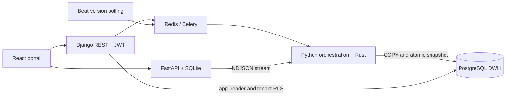
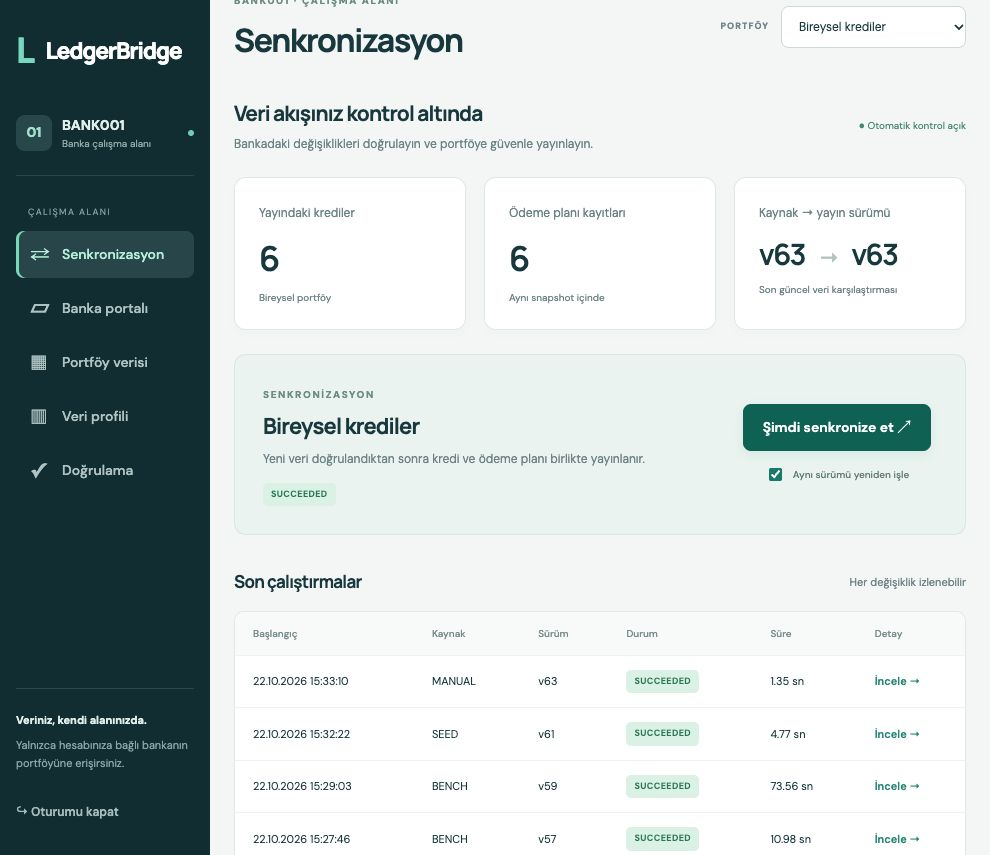
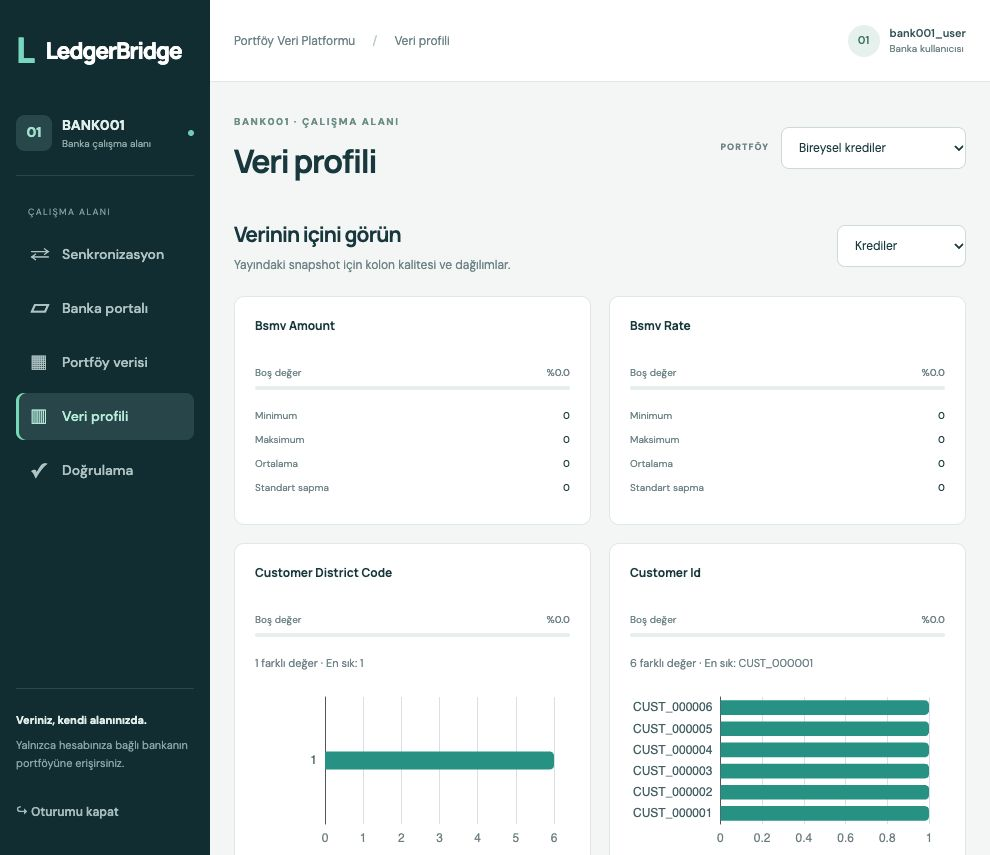
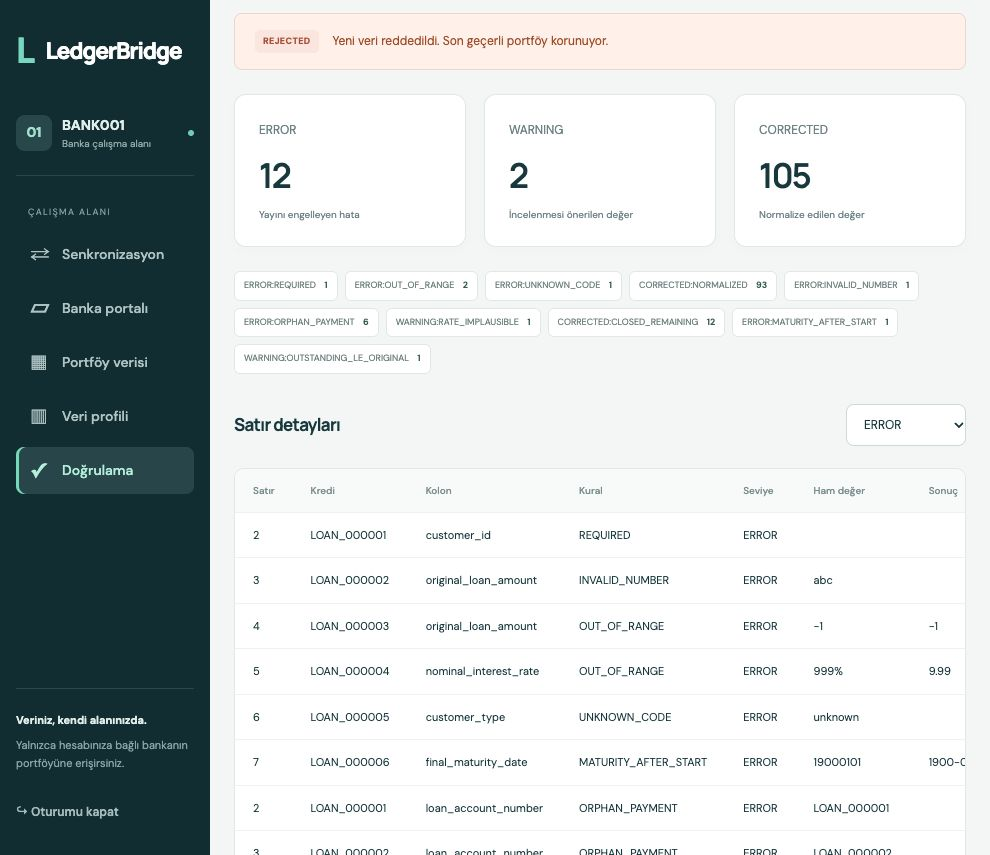

# LedgerBridge Loan Portfolio Adapter

[](https://github.com/levend18/ledgerbridge-loan-adapter/actions/workflows/ci.yml)

A multi-tenant financial-data adapter that streams retail and commercial loan
portfolios from a simulated bank, normalizes and validates them with Rust, and
publishes complete snapshots to PostgreSQL. Rejected updates preserve the last
valid portfolio. JWT and database RLS enforce tenant isolation. The React portal
supports source uploads, sync, data browsing, profiles and validation evidence.



## Quick start

Prerequisites: a running Docker Engine/Desktop, Compose v2+ and make. Python,
Rust and Node are built inside containers; no host installation is required.
The first build downloads locked dependencies. Start with at least 10 GB free
space for images and the benchmark: temporary NDJSON/COPY, SQLite and PostgreSQL
use more disk than the source CSV alone.

```bash
git clone https://github.com/levend18/ledgerbridge-loan-adapter.git
cd ledgerbridge-loan-adapter
cp .env.example .env
make up
make seed
make verify
```

Portal: http://localhost:5173 · API: http://localhost:8000 ·
Swagger: http://localhost:8000/api/docs/ · Bank: http://localhost:8001.

| User | Tenant | Password |
|---|---|---|
| bank001_user | BANK001 | demo1234 |
| bank002_user | BANK002 | demo1234 |
| bank003_user | BANK003 | demo1234 |

Credentials and bank keys are local-demo defaults. Host ports bind to loopback.
If the four source CSVs exist under ignored `data/`, seed reads them without
modification; otherwise it generates synthetic data. Tenant assignment uses the
first eight SHA-256(customer_id) bytes modulo three; plans follow their credit.
Private CSVs, environment files and local agent instructions are excluded from Git.

## Using the portal

Login with a tenant account. In the bank portal, upload credit and payment-plan
CSV files (UTF-8, semicolon delimiter). Replace overwrites a dataset; PATCH upserts
business keys. The bank retains raw strings. Source polling defaults to 30 seconds;
manual sync is also available. Source and published versions are shown separately.

ERROR rejects the batch; WARNING and CORRECTED allow publication and remain
visible in the validation view. Credit and plan share one snapshot. Pagination
cursors are snapshot-bound: use the restart button after a stale-cursor error
to load the new snapshot from its first page. Cached pages are discarded only for
the selected tenant, portfolio and dataset.
Access JWTs expire after 15 minutes; sign out and sign in again when expired.
The current demo UI uses Turkish labels; repository documentation is English.

## Tenant isolation

**Method:** one shared schema, tables partitioned statically by `tenant_id`, and
PostgreSQL row-level security (RLS) on every reader-facing table.

**Why:** database-per-tenant gives the strongest operational separation but
multiplies provisioning, connections and backups; schema-per-tenant multiplies
every migration. For three banks, shared tables with tenant partitions keep one
migration path and one connection pool, while RLS makes isolation fail closed in
the database itself, so an application bug that forgets a tenant filter returns
no foreign rows. Partitions also keep each tenant's atomic replacement and
statistics local. The full trade-off is ADR-03 in [docs/tecnic.md](docs/tecnic.md).

Tenant identity comes from
JWT membership; a request parameter is only an equality check. API reads use
app_reader with transaction-local set_config and READ ONLY REPEATABLE READ.
Reader has no direct child-partition access. The worker's non-superuser BYPASSRLS
role is not available to the HTTP API. Tests cover both API and SQL boundaries.

## Tests and reports

```bash
make build       # Rebuild images after code changes
make lint        # Ruff, mypy, import-linter, Rust fmt/clippy, ESLint/Prettier
make test        # Rust and Python tests, frontend build and Vitest
make test-live   # Actual Celery/beat polling tests
make bench       # Fresh 50/200 MB runs, child RSS and Docker samples
make verify      # Lint, V-ID tests, live worker, benchmark and report
make seed        # Restore demo portfolios after destructive acceptance tests
make down
```

Tests alter the local demonstration data. `make verify` creates fresh evidence;
it does not accept an old benchmark as a new result. `verification-report.md` is
the human-readable output; raw JUnit and measurements are under ignored artifacts/.
A failed or missing MUST returns a nonzero exit code while still producing a report.
V-22 uses recorded manual browser evidence; its automated check validates the
evidence files, not a claimed automated UI run.

API-key auth, crashed-worker reaping, mixed fault-injection manifests, automated
Playwright and rate limiting remain SHOULD work. They are not presented as complete.

## Executable API examples

`tests/verification/test_v23_readme.py` extracts the following block from this
README and executes it against real HTTP services. If curl/jq are unavailable on
the host, use `docker compose run --rm dev sh` and set API=http://api:8000.
Run seed first and leave the worker running.

<!-- verification: curl -->
```bash
set -eu
API=${API:-http://localhost:8000}
TOKEN=$(curl -fsS "$API/api/auth/token" -H 'Content-Type: application/json' \
  -d '{"username":"bank002_user","password":"demo1234"}' | jq -er .access)
curl -fsS "$API/api/data?tenant_id=BANK002&loan_type=RETAIL&limit=2" \
  -H "Authorization: Bearer $TOKEN" | jq -c .
curl -fsS "$API/api/profiling?tenant_id=BANK002&loan_type=RETAIL" \
  -H "Authorization: Bearer $TOKEN" | jq -c .
RUN=$(curl -fsS "$API/api/sync" -H "Authorization: Bearer $TOKEN" \
  -H 'Content-Type: application/json' \
  -d '{"tenant_id":"BANK002","loan_type":"RETAIL","force":true}' | jq -er .sync_run_id)
for attempt in $(seq 1 60); do
  RESULT=$(curl -fsS "$API/api/sync/$RUN" -H "Authorization: Bearer $TOKEN")
  STATUS=$(printf '%s' "$RESULT" | jq -r .status)
  case "$STATUS" in
    SUCCEEDED) printf '%s\n' "$RESULT" | jq -c .; break ;;
    FAILED|REJECTED|SKIPPED) printf '%s\n' "$RESULT" >&2; exit 1 ;;
  esac
  sleep 1
done
test "$STATUS" = SUCCEEDED
```

Additional endpoints: `/api/runs?loan_type=RETAIL`,
`/api/validation-issues?sync_run_id=<uuid>&severity=ERROR`, and
`/api/data?loan_type=COMMERCIAL&dataset=payment_plan`. Anonymous requests receive
401, conflicting tenant parameters 403, and foreign run IDs 404.

## Screenshots

Screenshots use synthetic records only. See the [manual acceptance record](docs/UI_VERIFICATION.md).





## Measured performance

Measured on 22 October 2026: Apple M4, 16 GiB host RAM, Docker Linux/arm64
(7.748 GiB VM), Python 3.12.12 and PostgreSQL 16.10. Both runs used fresh Celery
child processes and 10,000 compatible credits. Measured at commit `01ed1ff`, with
exact high-cardinality profile completion enabled. Sizes are decimal MB.

| Plan CSV | Plan rows | Sync | Child peak RSS | Docker worker peak | GC |
|---|---:|---:|---:|---:|---:|
| 50,000,011 bytes | 686,161 | 17.659 s | 108.45 MiB | 141.10 MiB | 25 ms |
| 200,000,014 bytes | 2,717,294 | 67.553 s | 107.80 MiB | 163.60 MiB | 2406 ms |

Both runs **PASS**: child RSS ≤256 MiB and size-to-size RSS difference
**0.59%**, below 20%. The full sync duration includes download, validation, COPY,
publication and GC; source generation/upload is outside that timer. Docker samples
include the worker parent as well as the child. Timings vary by machine and load.
`make verify` reruns the benchmark and writes fresh evidence; these are the local
reference measurements. The earlier failed memory measurement and its correction
are documented in [architect.md](architect.md).

## Assumptions and open questions

- Interest units convert percent to fraction; monthly/annual periods are not
  converted. Commercial rate periodicity needs business confirmation.
- Customer type T/V meanings are unconfirmed and remain codes.
- Retail 100.00 interest values generate warnings rather than invented corrections.
- Installment-count inconsistencies and outstanding > original are warnings;
  authoritative totals and capitalization rules need clarification.
- External rating scales remain raw. ERROR tolerance defaults to zero; no partial
  portfolio acceptance is assumed.
- Rust bounds its category map at 1,000 values. PostgreSQL completes exact
  distinct/mode/top-ten statistics before publication for larger cardinalities;
  the worker receives only ten summary rows per column.
- Bank credit/plan uploads are separate transactions; a poll between uploads may
  reject the intermediate source state while preserving the previous DWH snapshot.
- Historical snapshots are not archived. DELETE GC bloat is left to autovacuum.

Read the [architecture diagrams](Architecture.md), [engineering challenges](architect.md),
[code tour](docs/CODE_TOUR.md), [technical design](docs/tecnic.md),
[acceptance contract](docs/VERIFICATION.md) and [progress log](docs/PROGRESS.md).
